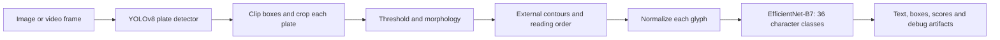

# License plate identification with YOLOv8 and EfficientNet-B7

A runnable reconstruction of **Encompassing YOLOv8 and EfficientNet B7 for Automatic License Plate Identification**, ICCCIS 2023. It connects plate detection, contour segmentation, and character classification in one Python package, with data preparation, training, evaluation, image inference, and video inference.

[Paper / DOI](https://doi.org/10.1109/ICCCIS60361.2023.10425775) · [Paper alignment audit](docs/PAPER_ALIGNMENT.md) · [Data sources](docs/DATASETS.md) · [Verification](docs/VERIFICATION.md)

**Status:** the software workflow is implemented and tested. The original detector checkpoints and notebooks are preserved. The original trained B7 weights, exact split indices, and private 500-image benchmark have not been recovered. Public dataset acquisition and reproducible training paths are provided. **Published scores below are historical claims, not reproduced results from this implementation.**

## Architecture



YOLO predicts one foreground class: `license_plate`. Background is implicit. Each detected plate is processed independently; its characters are ordered by row and then horizontally. The recognizer outputs `0–9` and `A–Z`. There is no EasyOCR, Tesseract, or alternate detector hidden in this pipeline.

## Quick start

Use Python 3.11 or newer. Run commands from the repository root. A virtual environment keeps dependencies isolated.

```bash
python3 -m venv .venv
source .venv/bin/activate
python -m pip install -e '.[dev,legacy]'
alpr doctor
alpr --help
```

`legacy` installs `dill`, required by the archived 2023 detector. On Windows, activate with `.venv\Scripts\activate`. For CUDA machines, install a compatible PyTorch build following [PyTorch's installation instructions](https://pytorch.org/get-started/locally/) before installing this package.

For project-local caches, especially in a restricted environment:

```bash
export TORCH_HOME="$PWD/artifacts/torch"
export YOLO_CONFIG_DIR="$PWD/artifacts/ultralytics"
export MPLCONFIGDIR="$PWD/artifacts/matplotlib"
```

CPU works for tests and small experiments. B7 full training is computationally expensive; use an appropriate GPU for the full datasets. `alpr doctor` reports CUDA and Apple MPS availability. Recognition accepts `--device auto`, `cpu`, `mps`, or `cuda:0`; detector commands also support Ultralytics device strings such as `0` for CUDA GPU 0. Use `cpu` for the most portable workflow.

### Run a complete software smoke test without external data

```bash
python scripts/smoke_test.py --output runs/software-smoke
```

This generates small synthetic fixtures, prepares splits, trains YOLOv8n and EfficientNet-B0 for one epoch, evaluates both, runs the full pipeline, and checks report denominators. It downloads no pretrained model weights. Select `--architecture efficientnet_b7` to exercise full B7 fine-tuning instead. B0 is only the faster smoke-test option; B7 remains the actual training default.

The generated models are unsuitable for real recognition. The smoke test verifies execution, not research accuracy. Use a new output directory for each run; existing results are not silently overwritten.

## Obtain the public data

```bash
python scripts/download_datasets.py --dataset all
python scripts/prepare_public_data.py --dataset all --quarantine-conflicts
```

The downloader saves archives, extracts them under `data/downloads/`, and records source URLs, versions, archive hashes, and file counts in `source.json`. It rejects path traversal, symlinks, duplicate ZIP entries, and excessive archive sizes. Archives and image data are ignored by Git. See [the data ledger](docs/DATASETS.md) for the exact provenance and differences from the paper.

The versioned Mercosur archive is about 1.6 GB; allow additional disk space for extraction and prepared copies. The pinned public character archive is a candidate/replacement for the unavailable original Kaggle source. It must not be described as a verified recovery of the exact original character data.

Prepared public data are written to `data/prepared/mercosur`, `data/prepared/characters`, and `data/prepared/openalpr`. The character archive has 37,623 images; 30 conflicting copies are explicitly quarantined, leaving 37,593. The Mercosur archive has 3,832 images and eight orphan label files. The OpenALPR conversion yields 443 usable labeled images. See the data ledger for all exclusions.

The original private phone benchmark cannot be regenerated by downloading training data. End-to-end evaluation on another public dataset must be named and reported separately.

## Prepare detection data

Expected input structure (subdirectories are allowed when labels mirror image paths):

```text
data/raw/detection/
├── images/
│   ├── scene001.jpg
│   └── scene002.jpg
└── labels/
    ├── scene001.txt
    └── scene002.txt
```

Each annotation line follows YOLO's normalized format:

```text
0 x_center y_center width height
```

For example: `0 0.5 0.6 0.3 0.1`. Class ID must be **0**. Coordinates must be finite and inside the image; width and height must be positive. An empty label file explicitly marks a negative image. A missing label is an error, not an assumed negative.

```bash
alpr prepare-detection \
  --images data/raw/detection/images \
  --labels data/raw/detection/labels \
  --output data/prepared/mercosur \
  --val-fraction 0.1 --test-fraction 0.1 --seed 42
```

The command validates decoding and annotations, writes `data.yaml`, and saves `manifest.csv` plus `dataset.json`. The manifest records original paths, byte hashes, annotation hashes, group IDs, and split membership. Identical image files stay in the same split. Conflicting annotations for identical files are rejected.

**Related images need explicit grouping.** Byte hashes cannot detect a re-encoded duplicate, neighboring video frames, or alternate views of the same vehicle. If those occur, supply `--groups data/raw/groups.csv`:

```csv
path,group
scene001.jpg,vehicle-001
scene002.jpg,vehicle-001
scene003.jpg,vehicle-002
```

Every image needs a group when this option is used. Entire groups are assigned together. Fractions are approximate by group count, so inspect the recorded sample counts, particularly for unequal groups. Prepared YOLO data use absolute roots: regenerate preparation after moving the dataset directory.

## Prepare character data

The default layout uses one folder per literal character:

```text
data/raw/characters/
├── 0/  ...  9/
└── A/  ...  Z/
```

Each folder contains glyph images. The persistent output vocabulary is exactly:

```text
0123456789ABCDEFGHIJKLMNOPQRSTUVWXYZ
```

```bash
alpr prepare-characters \
  --source data/raw/characters \
  --output data/prepared/characters \
  --val-fraction 0.1 --test-fraction 0.1 --seed 42
```

Splitting is stratified by character and groups identical image files. Every class requires at least three independent image groups. The actual counts are recorded; small classes cannot achieve exact percentages.

If folders are numeric class IDs, use `--mapping your-mapping.json`. The mapping must explicitly cover all 36 classes. [The example mapping](configs/character-mapping.example.json) demonstrates one convention; **verify it against the dataset rather than assuming it is correct**. Folder names such as `class_A` also require an explicit mapping. Identical files assigned to different characters are rejected for review by default. `--quarantine-conflicts` explicitly excludes every copy of conflicting hashes and records the exclusions; it never guesses a replacement label.

## Run the prepared public experiment end to end

```bash
python scripts/run_public_experiment.py --prepared data/prepared --output runs/public-experiment --device auto
```

This trains a fresh detector for 10 epochs and B7 for 15 epochs, evaluates both on their test partitions, evaluates the separate public benchmark with per-region reporting, and saves an annotated example. `progress.json` records completed stages. `--recognizer-checkpoint` can explicitly reuse a separately trained B7 checkpoint; provenance remains in the reports. Full runs can take substantial time on a personal computer.

## Train

### YOLOv8 detector

```bash
alpr train-detector \
  --data data/prepared/mercosur/data.yaml \
  --output runs/detector \
  --model yolov8n.pt \
  --epochs 10 --batch-size 16 --image-size 640 --device cpu
```

`yolov8n.pt` downloads official pretrained weights on first use. Use `yolov8n.yaml --no-pretrained` only for training from scratch. Horizontal and vertical flips are disabled to avoid mirrored plate text. The generated manifest and directory contents are audited before training. Outputs include Ultralytics logs/plots, `runs/detector/fit/weights/best.pt`, and `experiment.json` with configuration, environment, hashes, and validation metrics.

### EfficientNet-B7 recognizer

```bash
alpr train-recognizer \
  --manifest data/prepared/characters/manifest.csv \
  --output runs/recognizer-b7 \
  --architecture efficientnet_b7 \
  --epochs 15 --batch-size 16 --learning-rate 0.0001 \
  --image-size 80 --device auto
```

Default: ImageNet initialization, all layers fine-tuned, Adam, integer-label cross-entropy, and modest affine augmentation. The classifier is global pooling → Dense(128) → ReLU → dropout(0.5) → 36 logits. Integer-label cross-entropy is equivalent to one-hot categorical cross-entropy. The 80-pixel input is taken from the archived notebook rather than B7's ImageNet evaluation resolution.

Raw glyphs are binarized with Otsu and automatic border-based polarity, tightly cropped, centered with aspect ratio preserved on a 44×44 black canvas, resized, replicated into three channels, and normalized with ImageNet mean/std. Segmented glyphs share the same centering and normalization path. `--glyph-method`, `--glyph-polarity`, and `--glyph-threshold` make source-data preprocessing explicit. No label-dependent preprocessing is used.

Checkpoints contain the vocabulary, architecture, image size, preprocessing settings, epoch, validation results, and experiment provenance. `best.pt` is chosen by **validation loss**; `last.pt`, `history.json`, and `experiment.json` are also saved. The test split is never used for model selection. All validation/test samples are evaluated, including partial batches.

`--freeze-backbone` trains only the head and keeps backbone BatchNorm statistics fixed. This is a different transfer-learning experiment and is recorded as such. `--no-pretrained` and `--no-augment` are available for controlled tests. Keras `.h5` files are not compatible with these PyTorch checkpoints.

### Comparison architectures

The same training and evaluation interface supports all five architectures discussed in the paper:

```bash
for architecture in efficientnet_b0 mobilenet_v2 resnet50 inception_v3; do
  alpr train-recognizer \
    --manifest data/prepared/characters/manifest.csv \
    --output "runs/$architecture" --architecture "$architecture" \
    --epochs 15 --learning-rate 0.0001 --device auto
done
```

Use the same prepared manifest and seed across comparisons. These baselines use the same new classifier head and preprocessing; they are not exact recreations of every historical notebook head or optimizer. InceptionV3 requires an input of at least 75 pixels.

## Evaluate on held-out data

```bash
alpr evaluate-detector \
  --data data/prepared/mercosur/data.yaml \
  --weights runs/detector/fit/weights/best.pt \
  --output runs/detector-test --split test --device cpu

alpr evaluate-recognizer \
  --manifest data/prepared/characters/manifest.csv \
  --weights runs/recognizer-b7/best.pt \
  --output runs/recognizer-b7/test-metrics.json --split test --device cpu
```

Detection reports mAP50, mAP50–95, precision, and recall. Character evaluation reports argmax accuracy, per-class precision/recall/F1, macro and support-weighted averages, and a confusion matrix (rows=true, columns=predicted). Undefined class precision/recall is zero. Macro averages include all 36 classes; classes with no test support are shown explicitly. Metrics are stored as fractions, not percentages.

Rehashing the full prepared manifest catches changed files and exact duplicate/group leakage across splits. It does not establish independence of semantically similar images; grouping and dataset design remain essential.

## Recognize images and directories

After training a recognizer:

```bash
alpr infer \
  --detector runs/detector/fit/weights/best.pt \
  --recognizer runs/recognizer-b7/best.pt \
  --source data/examples/car.jpg \
  --output runs/prediction --debug --device cpu
```

`--source` also accepts a directory and processes supported image files recursively. Outputs include `predictions.json`, annotated JPEGs, `weights.json` with weight hashes, and optional plate crops, threshold masks, and individual glyph crops under `debug/`.

The archived detector can be selected with:

```text
--detector Code/YOLO_V8_resluts/weights/best.pt
```

Its single class is historically named `LP`. It loads in the verified environment, but its original split provenance is missing. Its evaluation on a newly reshuffled copy of the same dataset must not be represented as an independent test.

Each plate result includes original-image pixel `box` coordinates in `[x1, y1, x2, y2]`, detector `confidence`, `text`, `recognition_confidence`, character-level results, and `status`. Recognition confidence is the minimum character softmax score; it is not a calibrated probability of complete plate correctness. A detection with no segmented characters returns empty text and `no_characters`. No detections is a valid empty list.

`--min-character-confidence` labels uncertain results as `low_confidence` without replacing their text. Evaluation still scores those predictions; confidence gating cannot silently remove difficult examples.

### Segmentation settings

The default uses fixed threshold 200, a 333×75 plate canvas, an explicit 3×3 erosion/dilation kernel, external contours, relative character-size filtering, and row-aware ordering. Character holes are not returned as duplicate characters. Intermediate images stay in memory unless debug output is requested.

```text
--segmentation configs/segmentation-paper.json
--segmentation configs/segmentation-two-line.json
```

The two-line preset increases plate height and uses Otsu/automatic polarity. These are explicit extensions to the paper. Tune thresholds and filters on validation data only; touching characters, tilted plates, logos, bolts, and unusual layouts can still defeat contour segmentation. There is no perspective-rectification model in this method.

## Video inference

```bash
alpr video \
  --detector runs/detector/fit/weights/best.pt \
  --recognizer runs/recognizer-b7/best.pt \
  --source data/examples/traffic.mp4 \
  --output runs/video --stride 2 --device cpu
```

Frames are processed incrementally. Outputs are `annotated.mp4`, one JSON record per sampled frame in `predictions.jsonl`, `video.json`, and weight hashes. Records retain original frame indices and timestamps. Output FPS is input FPS divided by stride. The output has no audio. This is per-frame inference without tracking or temporal voting.

## Full-image end-to-end evaluation

Create a UTF-8 JSONL manifest, one image per line, with pixel-coordinate ground-truth boxes and complete transcriptions. Image paths are relative to the manifest:

```json
{"image":"images/car001.jpg","plates":[{"box":[120,240,340,300],"text":"AB12CD3456"}]}
{"image":"images/no_plate.jpg","plates":[]}
```

```bash
alpr evaluate \
  --detector runs/detector/fit/weights/best.pt \
  --recognizer runs/recognizer-b7/best.pt \
  --manifest data/benchmark/truth.jsonl \
  --output runs/end-to-end-test --match-iou 0.5 --device cpu
```

Detections are greedily matched one-to-one to ground truth by descending detector confidence and IoU. Text never influences matching. Reports include:

- Exact plate matches divided by **all ground-truth plates**, including missed detections.
- Exact image matches, requiring every plate transcription and no extra detection.
- Detection precision/recall, missed plates, and false-positive plate counts.
- Character error rate: Levenshtein edits over ground-truth characters, with misses as deletions and unmatched predictions as insertions. It may exceed 1.
- Per-image results, source/weight hashes, settings, environment, and measured latency.

Text normalization uppercases and removes ASCII whitespace and hyphens; it does not substitute `O/0`, `I/1`, or other confusable characters. Duplicate image paths/content and invalid boxes/transcriptions are rejected. Blank denominators are JSON `null`, not fabricated accuracy. Latency includes detector, segmentation, and recognizer work, excludes file I/O, and includes first-run warmup effects; it is not a real-time throughput guarantee.

## Paper results and reproduction boundaries

| Measurement | Reported in paper | Status here |
| --- | ---: | --- |
| Detection mAP50 | 99.5% | Historical claim; original artifacts preserved |
| B7 character accuracy | 98.22% | Historical claim; original recognition weights unavailable |
| Full-plate recognition, private phone set | 483 / 500 = 96.6% | Original labeled benchmark unavailable |

<!-- PUBLIC_RESULTS_START -->

Full public-data training is in progress. Final held-out metrics will be recorded only after the full workflow and verification checks finish.

<!-- PUBLIC_RESULTS_END -->

The archived detector CSV's final row contains mAP50 **0.99496** and mAP50–95 **0.9795**. This is a preserved training/validation log, not a fresh test. Its `args.yaml` references `facemask.yaml`, and the dataset/split linkage is not recoverable from those files alone.

The [audit](docs/PAPER_ALIGNMENT.md) documents corrections to background labeling, split isolation, threshold/Otsu behavior, morphology, contour ordering, model loading, and multiclass metrics. The new default split is **80/10/10 train/validation/test**, replacing the paper's ambiguous 80/20 training/test protocol to reserve a genuine test partition. Framework, preprocessing, and baseline-head differences are explicit. No unverified novelty, lightweight, or real-time claim is made.

## Tests and reproducibility

```bash
ruff check src tests scripts
ruff format --check src tests scripts
pytest -q
python -m build
```

Tests cover invalid annotations, hash changes, leakage, label mapping, reading order, contour holes, no-detection behavior, crop bounds, image/video output, multiclass metrics, missed/duplicate detections, real model forward passes, and checkpoint reload/batching. Neural smoke tests use random initialization and require no pretrained-weight download. `pytest -m 'not integration'` skips the larger model/checkpoint tests.

[CI](.github/workflows/ci.yml) runs lint, formatting, tests, and packaging on Python 3.11 and 3.13. The [verification ledger](docs/VERIFICATION.md) separates local verification from hosted CI and real-data model results. Seeds, hashes, and environments are recorded; deterministic settings reduce variation but do not guarantee bit-identical GPU results across software/hardware versions.

## Repository layout

```text
src/alpr/               Installable implementation and CLI
  data.py               Validation, grouped splits, manifests
  segmentation.py       Thresholding, morphology, contours, glyphs
  detection.py          YOLOv8 training/evaluation/inference adapter
  recognition.py        Character networks, preprocessing, checkpoints
  training.py           Character training and held-out metrics
  pipeline.py           Full-image, directory, video and benchmark paths
  metrics.py            Classification and full-pipeline metrics
configs/                Segmentation, mapping and public dataset sources
scripts/                Dataset download, synthetic fixture and smoke runner
tests/                  Unit and real-model integration tests
docs/                   Audit, data provenance and verification ledger
Code/                   Preserved historical notebooks and detector artifacts
images/                 Historical paper figures; not raw evaluation samples
data/                   Downloaded/prepared data (ignored)
runs/                   New experiments and outputs (ignored)
```

## Troubleshooting and limitations

| Symptom | Action |
| --- | --- |
| Missing recognizer checkpoint | Train with `alpr train-recognizer`; ImageNet weights alone do not recognize plate characters. |
| `No module named dill` with archived weights | Install `python -m pip install -e '.[legacy]'`. |
| Dataset file changed / leakage error | Review the input and grouping, then prepare into a new directory. Do not edit hashes to bypass the check. |
| No characters / incorrect ordering | Inspect `--debug`; adjust threshold, polarity, relative size filters, or two-line preset using validation data. |
| Out of memory | Reduce batch size; consider freezing the backbone as a separately reported experiment. |
| No CUDA/MPS available | Use CPU for verification or run full training on a supported GPU; check `alpr doctor`. |
| Existing output directory | Choose a new run name to preserve previous results. |
| Moving prepared detection data | Regenerate preparation so `data.yaml` points to the new absolute root. |

The vocabulary excludes regional scripts. Contours can merge or split characters under blur, occlusion, touching strokes, strong skew, or decorative text. There is no format-specific grammar correction. Data source shift between Mercosur training scenes and Indian phone photos must be assessed with independent labeled data. The method's limitations cannot be eliminated by changing README claims.

## Attribution and license

Paper authors in published order: **Rohan Reddy B, Engu Himesh, Gunti Swathi, and Southarrajan S**.

```bibtex
@inproceedings{alpr2023yolov8efficientnet,
  author = {{Rohan Reddy B} and {Engu Himesh} and {Gunti Swathi} and {Southarrajan S}},
  title = {Encompassing YOLOv8 and EfficientNet B7 for Automatic License Plate Identification},
  booktitle = {2023 International Conference on Computing, Communication, and Intelligent Systems (ICCCIS)},
  year = {2023},
  pages = {694--700},
  doi = {10.1109/ICCCIS60361.2023.10425775}
}
```

The earlier README linked a missing MIT license. No replacement license grant is invented here; see [NOTICE.md](NOTICE.md). The IEEE paper, public datasets, dependencies, and model weights retain their own terms. Consult [Ultralytics licensing](https://www.ultralytics.com/license) for distribution/deployment requirements. Historical material is preserved rather than relicensed.
